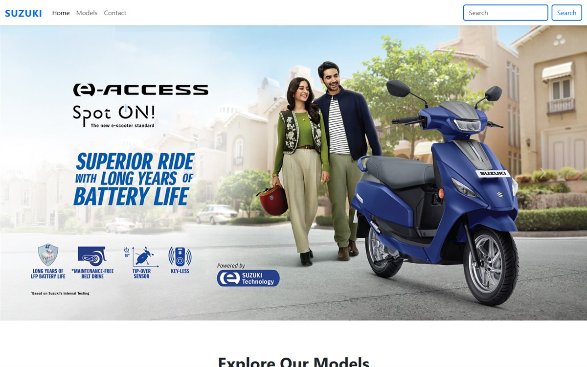

# Suzuki Motorcycles Landing Page

[](https://akarshkv1234-glitch.github.io/SuzukiMotors/)
[](https://developer.mozilla.org/docs/Web/HTML)
[](https://developer.mozilla.org/docs/Web/CSS)
[](https://developer.mozilla.org/docs/Web/JavaScript)
[](https://getbootstrap.com/)



A responsive landing page inspired by the Suzuki Motorcycles India website,
built to practice real-world layouts with Bootstrap.

**Live demo:** https://akarshkv1234-glitch.github.io/SuzukiMotors/

## Features

- Responsive navbar with search
- Hero carousel highlighting featured models
- Model showcase sections
- Contact footer
- Mobile-friendly layout

## Built with

- HTML5
- CSS3
- JavaScript
- Bootstrap 5
- Bootstrap Icons

## Run locally

Open `index.html` in a browser, or serve the folder:

```bash
python -m http.server 8000
```

## Note

This is an educational front-end clone. It is not affiliated with or endorsed
by Suzuki. All trademarks belong to their respective owners.
